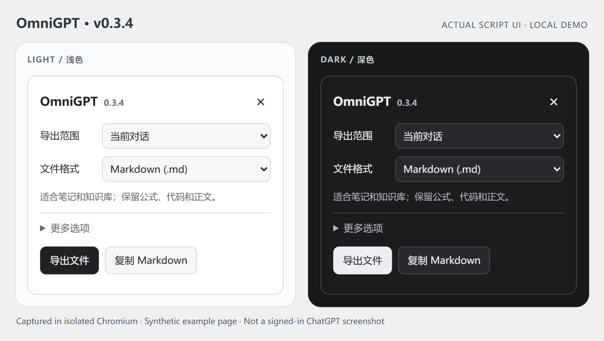
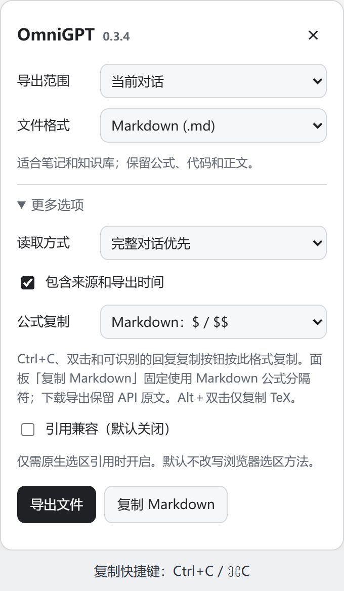

<p align="right"><a href="README_ZH.md">简体中文</a> · <strong>English</strong></p>

<div align="center">

<h1>OmniGPT</h1>

<p><strong>Archive your chats. Keep your math editable.</strong></p>
<p>A lightweight userscript for exporting ChatGPT conversations and copying editable LaTeX. Runs in a userscript manager such as Tampermonkey.</p>

<p>
  <a href="https://raw.githubusercontent.com/sakur7a/OmniGPT/main/OmniGPT.user.js"><strong>Install Script</strong></a>
  &nbsp; · &nbsp;
  <a href="https://greasyfork.org/en/scripts/590463-omnigpt-chatgpt-export-latex-copy">Greasy Fork</a>
  &nbsp; · &nbsp;
  <a href="#getting-started">Usage</a>
  &nbsp; · &nbsp;
  <a href="https://github.com/sakur7a/OmniGPT/releases">Releases</a>
</p>

<p>
  <a href="https://github.com/sakur7a/OmniGPT/releases/latest"></a>
  <a href="https://github.com/sakur7a/OmniGPT/actions/workflows/build-userscript.yml"></a>
</p>

</div>

<p align="center">
  
</p>
<p align="center"><sub>v0.3.4 actual userscript UI · isolated local example · not a signed-in ChatGPT capture</sub></p>

**Conversation export** — Save the current conversation or accessible history as Markdown, JSON, TXT or reference-material chunks.<br>
**Math copying** — Use selection copy or a recognized reply-copy button to keep inline/display TeX, including replies that mix formulas and code.<br>
**On-demand runtime** — Math is processed when you copy; exports run when requested; the full panel is created on first opening.

This guide describes **v0.3.4**. See the [0.3.4 changes](docs/V0.3.4.md) for the current-page copy repair. OmniGPT is a **userscript**, not a standalone browser extension; the userscript manager is the browser extension you install first.

## Getting started

### Install

1. Install [Tampermonkey](https://www.tampermonkey.net/) in your browser. Chrome / Edge with Tampermonkey is the primary target.
2. Open the **[GitHub Raw install URL](https://raw.githubusercontent.com/sakur7a/OmniGPT/main/OmniGPT.user.js)** and confirm installation in the manager. Alternatively, install from [Greasy Fork](https://greasyfork.org/en/scripts/590463-omnigpt-chatgpt-export-latex-copy), checking the version published there.
3. Make sure OmniGPT is enabled, then reload an existing conversation on [chatgpt.com](https://chatgpt.com/). The legacy `chat.openai.com` host is also matched.
4. Click **OmniGPT** in the lower-right corner to open the panel. On narrow windows it becomes an **O** button on the right side. The panel header shows the loaded script version.

The panel currently uses Chinese labels; English equivalents below include the relevant labels. Keep only one OmniGPT installation enabled to avoid competing copy handlers.

### Update an existing installation

1. Open Tampermonkey's dashboard, find **OmniGPT**, and use the manager's **Check for updates** action for that script. The wording and location can vary by manager version and language.
2. Confirm any offered update, then check the installed version. Automatic checks follow the manager's schedule; a GitHub push does not imply an immediate local update.
3. **Reload every ChatGPT tab you will use**, reopen the panel to check its loaded version, then copy the content again.

The generated script's `@updateURL` and `@downloadURL` point to the GitHub Raw URL above. Check the update source actually recorded in your manager: an installation using a Greasy Fork update source depends on the version published there. **GitHub Releases and Greasy Fork do not necessarily update together.** If no update is offered, use the same GitHub install URL to update the existing installation and verify the version before retrying. Maintainer sync instructions are in [RELEASING.md](docs/RELEASING.md).

## Copy formulas and code

| Action | Scope and result |
| :--- | :--- |
| Select a response, then `Ctrl+C` / `⌘C` | Copies the selection with recoverable formulas and basic Markdown structure; a partial rendered-formula selection restores that formula's full TeX |
| Click ChatGPT's **Copy** button below a reply | For a recognized action with supported math, copies that reply's assistant body blocks using the selected formula style |
| Double-click a rendered formula | Copies the complete formula, preserving inline/display form |
| `Alt` / `Option` + double-click | Copies only the formula's raw TeX, without delimiters |
| Panel **Copy Markdown (复制 Markdown)** | Copies the current conversation as Markdown; available only for **Current conversation (当前对话)** |

Selection copy and recognized reply-copy actions handle rendered formulas and raw `\(...\)` / `\[...\]` formulas in prose. Inline code, code blocks and escaped literal delimiters are protected. Ordinary selections without supported math, editor/input-field selections, code-copy buttons and unrecognized reply actions keep native behavior. Selecting a whole reply containing math may also serialize its headings, lists, links, code and basic tables as Markdown.

### Choose the formula format

Under **More options (更多选项) → Formula copy (公式复制)**:

| Setting | Inline formula | Display formula |
| :--- | :--- | :--- |
| **Markdown** — default | `$x_i$` | `$$` on separate lines around the TeX |
| **LaTeX** | `\(x_i\)` | `\[` and `\]` around the TeX |

For example, Markdown copy produces:

```markdown
The chain is $5\leq6\leq7$. Its mean is:

$$
\bar{x} = \frac{1}{n} \sum_{k=1}^{n} x_k
$$

The code example `\(literal\)` stays code.
```

The selected style persists across page reloads. Seeing `\(...\)` can be intentional if **LaTeX** was selected earlier. The panel's **Copy Markdown** always normalizes recognized math delimiters to Markdown, regardless of that setting. API-based file exports retain the source body's existing delimiters; page-based exports use the Markdown serializer.

`G_k` and `G\_k` retain their original meanings. If a renderer exposes no reliable TeX source, OmniGPT does not guess it from spoken accessibility labels. Optional **Quote compatibility (引用兼容)** is off by default; enable it only for ChatGPT's selection-to-quote flow. It is not required for either copy path above. See [clipboard behavior](docs/CLIPBOARD.md) for details.

## Export conversations

1. Open the panel and choose **Export scope (导出范围)**: current conversation or history.
2. Choose **File format (文件格式)**, adjust **More options (更多选项)** if needed, then click **Export file (导出文件)**.
3. Watch the progress and warnings. Use **Cancel (取消)** to stop; closing the panel also cancels an active read.
4. If several reference chunks are generated, click each filename to save it. Closing the panel releases unsaved chunks.

| Format | Intended use |
| :--- | :--- |
| **Markdown** `.md` | Notes, knowledge bases and version control, with formulas and code in the body |
| **JSON** `.json` | Structured conversation data, acquisition source, completeness flags and warnings |
| **TXT** `.txt` | UTF-8 text for reading/search; Markdown already in API text may remain |
| **Reference chunks (参考材料分片)** `.md` | Message-boundary chunks for uploading as reference material; oversized single messages stay intact |

**Current conversation** defaults to API-first retrieval of the active branch, including paginated long conversations. If the read fails, OmniGPT can fall back to recognizable, already-loaded page content and marks it as partial. Choose **Loaded page only / offline (仅已加载页面（离线）)** to skip API retrieval. Unsupported page layouts may expose no exportable body.

**History** reads the current account's returned conversation list. Choose all returned entries or the most recent **50 / 200** in that list. It does not scan other workspaces or guarantee that archived/project conversations omitted from the list are included. Successful reads and failure details are retained; if all reads fail, no successful-looking empty archive is produced.

> **Exports are reference/archival files, not a full account backup or native ChatGPT history restore.** Page capture can miss unloaded content; API/list coverage and pagination limits still apply. Images and attachments are represented by available references or placeholders, not bundled binaries. Completeness warnings remain in the result.

## Panel options

| Option | Default | Meaning |
| :--- | :--- | :--- |
| Export scope (导出范围) | Current conversation | Select current conversation or accessible history |
| File format (文件格式) | Markdown | Select a download format; Copy Markdown remains Markdown |
| Read method (读取方式) | API-first (完整对话优先) | Current conversation only; optionally use loaded-page capture |
| History count (历史数量) | All returned entries | History only; optionally limit to 50 / 200 |
| Include source/time (包含来源和导出时间) | On | Controls optional metadata in text/Markdown output and reference chunks; JSON keeps its structure and warnings remain |
| Formula copy (公式复制) | Markdown | Controls selection, double-click and recognized reply-copy formula delimiters |
| Quote compatibility (引用兼容) | Off | Optional scoped selection-text compatibility for quoting |

<details>
<summary>v0.3.4 More options screenshot</summary>

<p align="center"></p>
<p align="center"><sub>Captured from the unmodified v0.3.4 userscript in a fresh headless Chromium context on a synthetic local example page. This shows UI rendering, not authenticated ChatGPT copy/export verification.</sub></p>

</details>

File format, metadata, formula style and quote compatibility are saved in the current site's local browser storage. Scope, read method and history count return to defaults on a new page load. Settings are not account-synced.

## Compatibility and privacy

- **Primary target:** ChatGPT web in Chrome / Edge with Tampermonkey. Only `https://chatgpt.com/*` and `https://chat.openai.com/*` match; subframes are excluded.
- **Coverage limits:** Firefox / Violentmonkey, standalone desktop clients and mobile setups do not have a complete compatibility matrix. A successful check on one setup does not establish all-browser coverage.
- **Page changes:** ChatGPT's DOM and history endpoints are not stable public APIs. Unknown layouts/actions can retain native copying or fail page export. Complex tables, image-only selections and unavailable TeX sources may not round-trip.
- **Paste targets:** Supported math copying writes `text/plain`, without KaTeX HTML / MathML. Destination editors or plugins can still transform that text.

The userscript has no ads, telemetry or third-party conversation uploads. Selection copy, recognized reply-copy actions and formula double-clicks do not read your clipboard or call the backend. The panel's Copy Markdown follows the current-conversation export path, so API-first mode can request conversation data. API reads reuse the current ChatGPT login session and request data only from the ChatGPT site; formatting and file generation happen locally. No API key is required.

By default there is no continuous page observer, polling, whole-page formula cache or global replacement of networking, Clipboard API or selection methods. There are no third-party runtime dependencies. Large archives still consume time and memory; start with 50 conversations if unsure.

## Troubleshooting

<details>
<summary><strong>No launcher, an old version, or copying still uses backslash delimiters?</strong></summary>

Check that the manager and the correct script are enabled on the supported host, keep one OmniGPT installation enabled, update it, and reload the source tab. Check the version in the panel, then choose **更多选项 → 公式复制 → Markdown** if you want dollar delimiters. Code examples remain literal by design. If a reply action is unrecognized, try selection copy, a formula double-click or the panel's Copy Markdown action. An update does not change text already in the clipboard.

</details>

<details>
<summary><strong>An export is partial or fails?</strong></summary>

Read the panel/file warnings. Loaded-page mode can only capture recognizable content already present in the page. History covers only returned list entries. Confirm that the ChatGPT session is usable and retry a smaller scope; API/layout changes can still require a script update. JSON and reference chunks cannot restore native chat history.

</details>

For a bug report, include the script, browser and manager versions, the specific copy/export action, a short nonprivate example, expected/actual plain text and redacted errors in [GitHub Issues](https://github.com/sakur7a/OmniGPT/issues). Do not post session cookies, access tokens or private conversations.

## Development

Use **Node.js 24** to match CI. Edit `src/`; the installable `OmniGPT.user.js` is generated. Node commands use built-in modules; Playwright is a development-only browser-test dependency.

```bash
git clone https://github.com/sakur7a/OmniGPT.git
cd OmniGPT
npm run build           # generate OmniGPT.user.js
npm run verify:release  # verify version and update metadata
npm run check           # build + metadata + syntax + Node regressions
```

<details>
<summary>Browser tests and what they verify</summary>

Create and activate a Python 3 virtual environment (`python -m venv .venv`; activate with `.venv\Scripts\Activate.ps1` in PowerShell or `source .venv/bin/activate` in bash/zsh), then run:

```bash
python -m pip install playwright==1.57.0
python -m playwright install chromium
python test/browser-regression.py
python test/browser-v030.py
python test/browser-current-dom.py
```

The scripts also accept `CHROMIUM_PATH` for an existing Chromium executable, for example `$env:CHROMIUM_PATH = 'C:\path\to\chrome.exe'` in PowerShell. Linux CI uses `python -m playwright install --with-deps chromium` to install system dependencies as well.

- **Node regressions:** math conversion and idempotence, export formatting, branching, pagination, retries and mocked API responses.
- **Browser regressions:** representative DOM fixtures and mocked site APIs, with actual Chromium keyboard, clipboard/MIME, paste, download and UI checks. The current-DOM suite covers both copy paths, code/mixed-content protection and multiple reply blocks.
- **Verification boundary:** these browser fixtures do not log into ChatGPT or launch desktop paste targets. They do not establish complete live-page or cross-browser compatibility.

The existing [CI workflow](.github/workflows/build-userscript.yml) runs these suites before a release for configured source/build/test changes. A README-only change does not match its push path filters.

</details>

```text
OmniGPT/
├─ OmniGPT.user.js              # generated, installable userscript
├─ src/
│  ├─ clipboard.js              # formulas, selections and reply-copy actions
│  ├─ exporter.js               # API/page collection and export formats
│  └─ omnigpt.js                # panel, options and task controls
├─ scripts/
│  ├─ build.mjs                 # assemble the userscript
│  └─ verify-release.mjs        # check version and update URLs
├─ test/
│  ├─ *.test.mjs               # Node regressions
│  ├─ browser-regression.py
│  ├─ browser-v030.py
│  └─ browser-current-dom.py
├─ docs/                       # design notes, version notes and demo assets
└─ .github/workflows/           # build, checks and existing release workflow
```

**Documentation:** [0.3.4 copy changes](docs/V0.3.4.md) · [Web API compatibility](docs/V0.3.1.md) · [Clipboard behavior](docs/CLIPBOARD.md) · [Earlier design notes](docs/V0.3.0.md) · [Release / Greasy Fork sync](docs/RELEASING.md). `README.md` and `README_EN.md` share the English guide; [README_ZH.md](README_ZH.md) is the Chinese guide.

---

### Credits and license

Export logic was adapted from the earlier `chatgpt-exporter` project. LaTeX compatibility ideas were informed by ChatGPT Better TeX Quote (schweigen, MIT) and TexCopyer (yjy / blime, GPL-3.0). See [THIRD_PARTY_NOTICES.md](THIRD_PARTY_NOTICES.md) for details.

[GPL-3.0-or-later](LICENSE) · [Report an issue](https://github.com/sakur7a/OmniGPT/issues) · [Releases](https://github.com/sakur7a/OmniGPT/releases)
